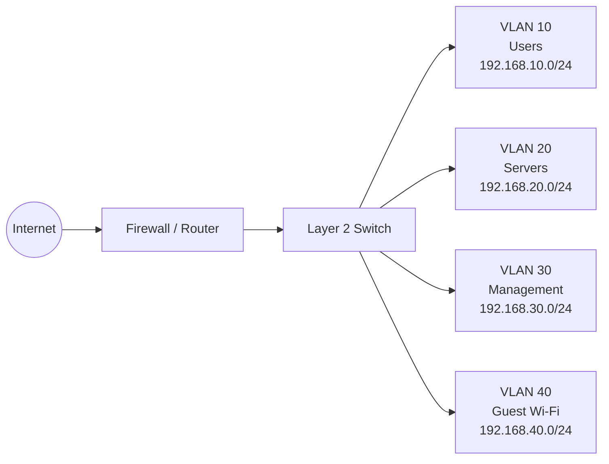

# Small Office Network Segmentation and Hardening Lab

A defensive network-design exercise for a small office. It documents a segmented VLAN layout, an access matrix, Cisco IOS-style configuration examples, and a validation checklist.

This is a reference lab, not a tested production configuration. Adapt syntax and controls to the device models and policy in an authorized lab environment.

## Objectives

- Separate user, server, management, and guest devices
- Apply least-privilege inter-VLAN access
- Describe switch-port hardening decisions
- Verify expected and denied paths systematically

## Topology

## Trust boundaries and policy

| Source | Destination | Policy | Reason |
|---|---|---|---|
| Users | Approved business services in Servers | Allow required ports only | Business use |
| Users | Management | Deny | Limit administrative exposure |
| Guest | Internal VLANs | Deny | Guest isolation |
| Guest | Internet | Allow via firewall policy | Internet-only access |
| Management workstation | Network device management | Allow SSH/HTTPS only | Controlled administration |
| Servers | Users | Deny by default; allow documented app flows | Reduce lateral movement |

Apply inter-VLAN policy on the firewall or Layer 3 gateway. The example switch configuration creates VLANs and a trunk; it does not implement the full firewall policy.

## Address plan

| VLAN | Name | Subnet | Gateway |
|---|---|---|---|
| 10 | USERS | 192.168.10.0/24 | 192.168.10.1 |
| 20 | SERVERS | 192.168.20.0/24 | 192.168.20.1 |
| 30 | MANAGEMENT | 192.168.30.0/24 | 192.168.30.1 |
| 40 | GUEST | 192.168.40.0/24 | 192.168.40.1 |

## Reference switch configuration

See [configs/access-switch.txt](configs/access-switch.txt). Interface numbers, available features, syntax, and gateway design vary by platform. Review before use.

## Validation checklist

1. Confirm VLANs and port assignments.
2. Verify only intended VLANs are allowed on trunks.
3. Confirm guest clients cannot reach internal subnets.
4. Confirm users can reach only approved services.
5. Confirm management access comes from the designated management segment.
6. Check that unused ports are administratively disabled and assigned to an unused VLAN.
7. Save test results and any deviations from the intended matrix.

## Safety

Use an isolated lab or equipment you administer. Do not apply sample configuration to production devices without review and explicit authorization.

## Limitations

This repository provides a design and reference configuration, not a Packet Tracer `.pkt` file. Validate the topology and syntax in your chosen simulator or hardware before relying on it.
